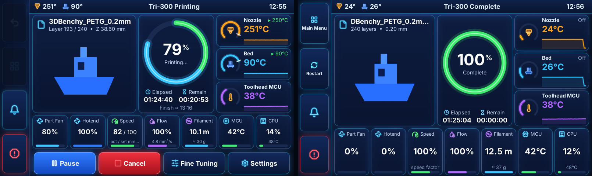
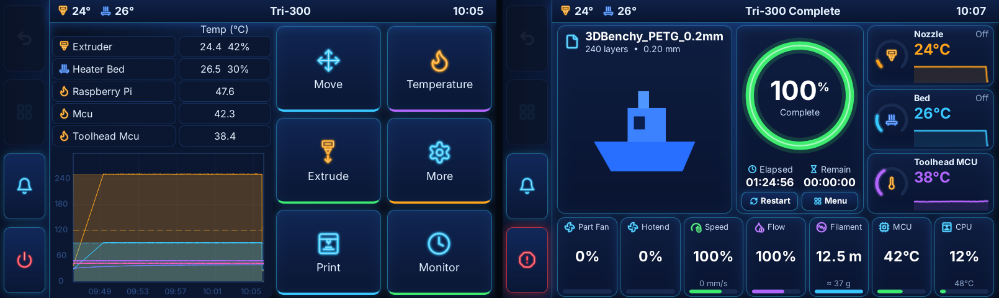

# KlipperScreen Neon

A neon theme and a new print monitor screen for [KlipperScreen](https://github.com/KlipperScreen/KlipperScreen).




Built and tested on KlipperScreen v0.4.7-206 with an 800x480 screen on a Raspberry Pi 4.
It needs a KlipperScreen build with add-on support (`enable_addons`).

## Features

- **Neon theme.** All 106 KlipperScreen icons are redrawn as glowing outline icons, and every menu and submenu is restyled with dark navy panels and blue outlines.
- **Print monitor.** Replaces the print status screen. It shows:
  - a progress ring with elapsed time, remaining time and estimated finish time
  - layer and Z height
  - nozzle, bed and a third sensor (chamber if you have one), each with a 5-minute temperature graph
  - part fan and hotend fan
  - speed, flow and filament used
  - MCU temperature, and the Pi's CPU load and temperature

  Every value is live data from Klipper or Moonraker; a missing sensor shows `N/A`. Tap a card to open its screen (Temperature, Fans, Fine Tuning, System).
- **Idle layout.** When no print is running, the bottom button row is hidden. Restart and Main Menu move into the progress card, and the indicator tiles grow into the free space. A neon standby image is shown when no file is loaded.
- **Compact temperature list.** The temperature list on the main menu is sized so every sensor fits without a scroll bar.
- **Monitor button.** A Monitor button is added to the main menu.
- **Update-proof.** A spare copy of the theme is kept inside the add-on folder, which KlipperScreen updates never touch. If `styles/neon` is deleted, or the theme is switched to another one, it is restored at the next start.
- **No changes to KlipperScreen's own files.** Only new files are added. The installer backs up `KlipperScreen.conf` before every change, and `--uninstall` restores your previous setup.

## Install

Over SSH on the Pi:

```bash
git clone https://github.com/KiatKiat/klipperscreen-neon ~/klipperscreen-neon
bash ~/klipperscreen-neon/install.sh
```

The installer:

1. backs up `KlipperScreen.conf` to `~/neon-ks-backup`
2. copies `styles/neon` and `addons/neon_monitor` into `~/KlipperScreen`
3. sets `theme = neon` and `enable_addons = True`
4. adds a Monitor button to the main menu
5. restarts KlipperScreen through Moonraker

Running it again is safe and updates the installed copy.

To update:

```bash
cd ~/klipperscreen-neon && git pull && bash install.sh
```

To remove everything and restore your previous theme:

```bash
bash ~/klipperscreen-neon/install.sh --uninstall
```

If your files are not in the default places, set these variables before running `install.sh`: `KS_DIR` (default `~/KlipperScreen`), `KS_CONF` (default `~/printer_data/config/KlipperScreen.conf`) and `MOONRAKER_URL` (default `http://127.0.0.1:7125`).

## Options

These go under `[main]` in `KlipperScreen.conf`:

| Option | Default | Effect |
|---|---|---|
| `neon_monitor` | `True` | `False` brings back the stock print status screen |
| `neon_lock_theme` | `True` | `False` lets you switch to other themes |
| `neon_compact_temps` | `True` | `False` brings back the stock main-menu temperature list |

## How it works

- `styles/neon/` is a standard KlipperScreen theme: `style.css`, `style.conf` and `images/*.svg`.
- `addons/neon_monitor/` is a KlipperScreen add-on that starts with KlipperScreen.
  - It sends the `job_status` panel to `panel.py`, which subclasses the stock panel. Pause, resume, cancel, time estimates and Z-offset saving all stay in the stock code.
  - It loads the print photo directly, so it does not wait behind the Print page's image queue.
  - If anything fails, it falls back to the stock screen.
- `tools/make_icons.py` regenerates the icon set from [Lucide](https://lucide.dev) outlines:

  ```bash
  python3 tools/make_icons.py <lucide-static>/icons styles/neon/images <spool.svg>
  ```

## License

AGPL-3.0, the same license as KlipperScreen. See [LICENSE](LICENSE).

The icon outlines come from Lucide under the ISC license; see [LICENSE-lucide.txt](LICENSE-lucide.txt). `spool.svg` is from KlipperScreen.
